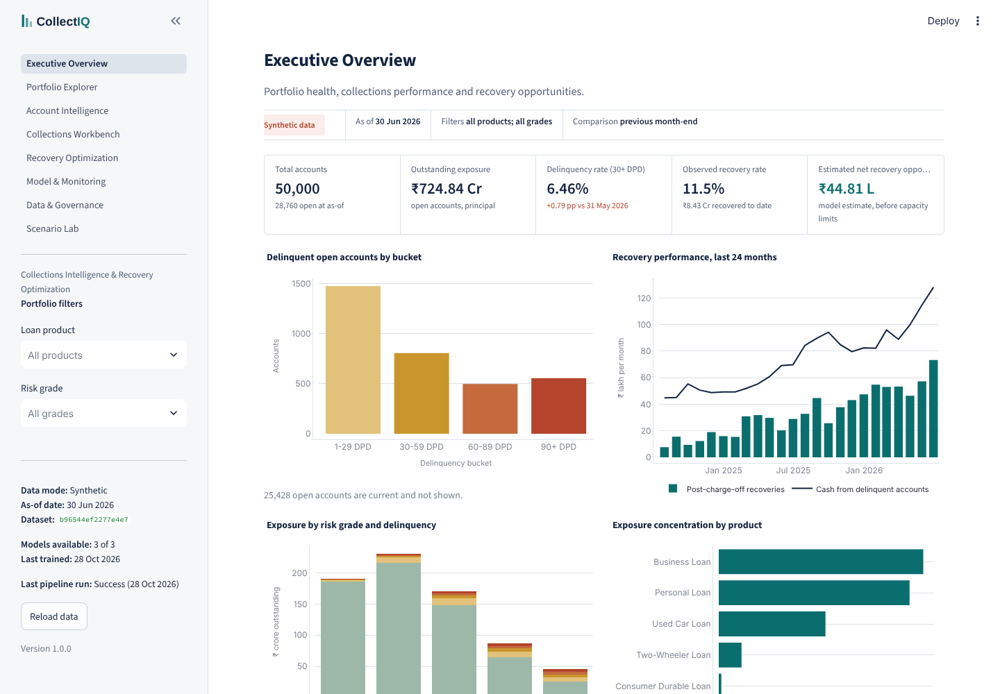
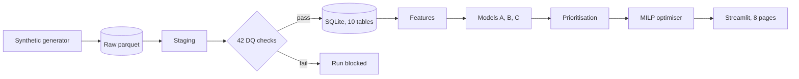
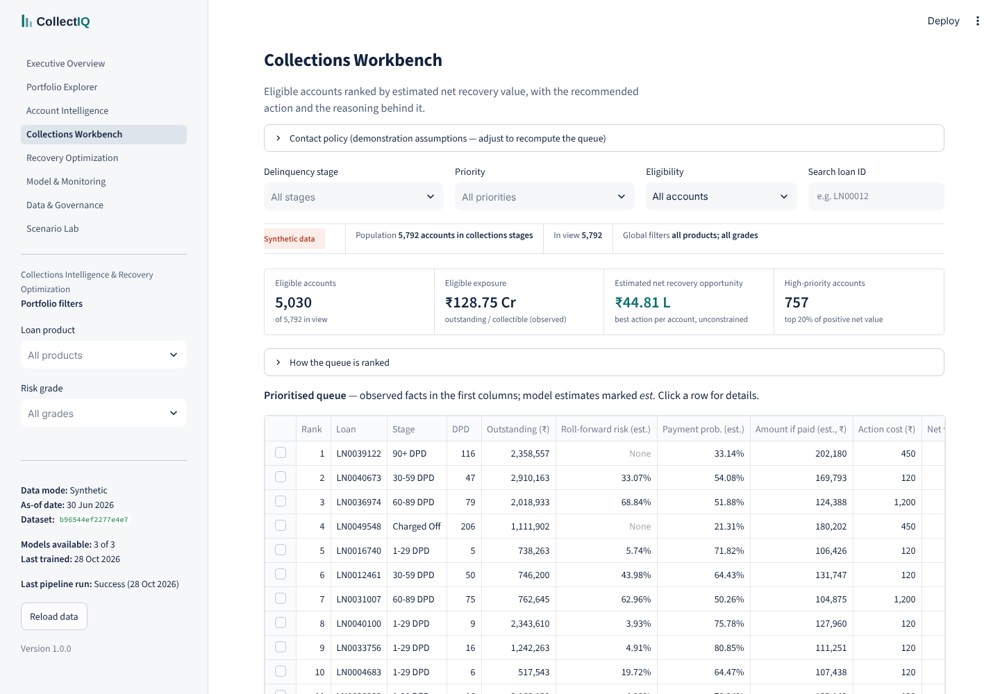
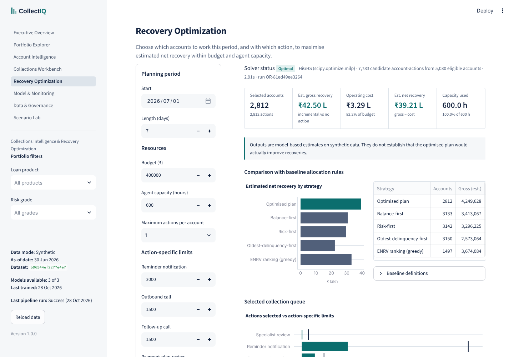
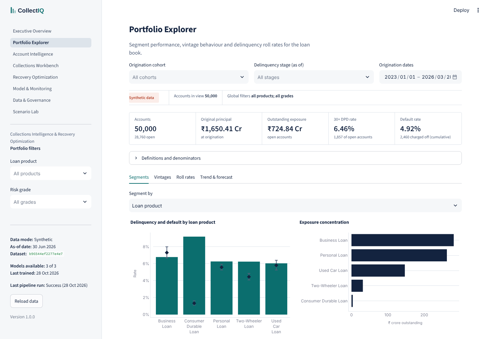
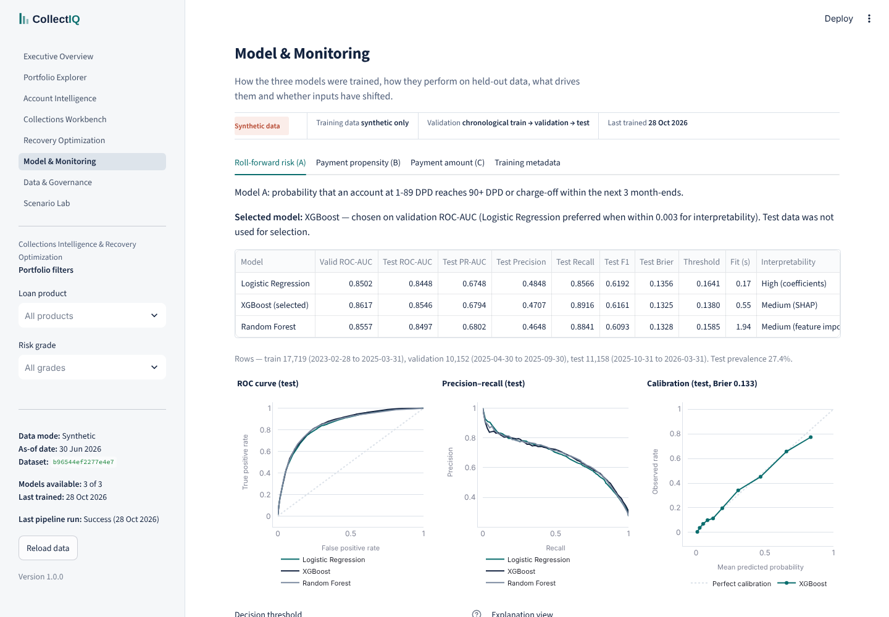

# CollectIQ

**AI-powered collections prioritisation and recovery optimisation for a lending book.**

CollectIQ helps a collections team decide *which overdue accounts to work this week, with
which action, within a fixed budget and agent capacity*. It combines a delinquency
roll-forward model, action-level payment models, an explainable prioritisation queue and
a mixed-integer optimiser, wrapped in an eight-page Streamlit product with full data
lineage and model monitoring.

> **Synthetic data.** Every record in this project is simulated. The preferred public
> source (LendingClub on Kaggle) could not be accessed through an authorised route in the
> build environment, so the documented synthetic fallback was used. Results describe a
> simulated book and are **not** evidence of real-world collection effectiveness.



## The business problem
A lender has thousands of delinquent accounts and limited collectors. Ranking by balance or
by risk sends effort to accounts that would pay anyway, or to accounts where nothing can be
recovered. CollectIQ separates three questions and keeps them separate in the UI:

| Question | Answered by |
|---|---|
| How likely is this delinquent account to roll into 90+ DPD or charge-off? | **Model A** — roll-forward risk |
| How much cash do we expect next month *with* each action, and *without* any? | **Models B × C** — payment propensity × amount |
| Where does an action add the most value after its cost, within budget and hours? | **Prioritisation + MILP optimiser** |

Accounts are ranked by **estimated net value = (expected cash with action − expected cash
with no action) − action cost**, not by risk alone.

## Key features
* **Reproducible data pipeline** — deterministic generator → staging → 42-check
  data-quality gate (critical failures block loading and training) → SQLite with keys,
  foreign keys, checks and indexes → features → models → decisions.
* **Leakage-safe modelling** — explicit prediction timestamps, chronological
  train/validation/test splits, a leakage guard on every feature list.
* **Three models, honestly compared** — Logistic Regression vs XGBoost (and Random
  Forest for Model A); the simpler model wins when it validates as well.
* **Explainability** — SHAP for tree models, exact linear contributions for logistic
  models, per-account rationale text built from the numbers.
* **Optimisation** — HiGHS MILP over account × action pairs with budget, hours,
  action-limit, per-account and optional coverage constraints, compared with four
  baseline rules under identical constraints; infeasibility explained; labelled
  heuristic fallback.
* **Governance** — dataset manifest with checksums, schema-generated data dictionary
  verified against the live database, DQ history, model-run registry, SHA-256-verified
  artifact loading, synthetic-data disclosure on every page.

## Results (executed, synthetic data, seed 42)
50,000 loans · 754,266 monthly snapshots · 62,534 collection events · as-of 30 Jun 2026.

| Model | Selected | Held-out test result |
|---|---|---|
| A — roll-forward risk (1-89 DPD → 90+/charge-off in 3 months) | XGBoost | ROC-AUC 0.855, PR-AUC 0.679, Brier 0.133 (LR 0.845) |
| B — payment propensity by action | Logistic Regression | ROC-AUC 0.831, PR-AUC 0.646 (XGBoost 0.827) |
| C — amount given payment | XGBoost regressor | expected-cash MAE ₹8,050; Σ predicted / Σ actual = 1.01 |

Default weekly plan (budget ₹4,00,000, 600 agent hours): the optimiser selects 2,812
accounts with **₹39.21 L estimated net value**, versus ₹30.65 L for a balance-first queue
(+₹8.55 L), ₹29.48 L for risk-first and ₹22.25 L for oldest-delinquency-first, under
identical eligibility and constraints. Full tables: [docs/MODEL_RESULTS.md](docs/MODEL_RESULTS.md)
(generated by the pipeline).

These are model estimates on simulated data. In this simulation, historical actions were
assigned at random within each delinquency stage, which is what makes action effects
identifiable; real collection logs would need A/B tests before the same reading is valid.

## Architecture

Details: [docs/ARCHITECTURE.md](docs/ARCHITECTURE.md).

## Quick start
```bash
git clone https://github.com/ayushkhandelwal-bits/collectiq.git
cd collectiq
python -m venv .venv && source .venv/bin/activate      # Python 3.11+ (tested on 3.13)
pip install -r requirements-dev.txt

python -m src.pipeline.run_pipeline                     # full build, ~50 s on 2 CPUs
streamlit run app.py                                    # http://localhost:8501
```
Lighter build: `COLLECTIQ_PROFILE=demo python -m src.pipeline.run_pipeline` (20,000 loans).
If you start the app without building, it offers a one-click build.

| Task | Command |
|---|---|
| Generate the synthetic source only | `python scripts/generate_data.py` |
| Full pipeline | `python scripts/run_pipeline.py` (or `python -m src.pipeline.run_pipeline`) |
| Re-score without retraining | `python -m src.pipeline.run_pipeline --skip-train` |
| Retrain models | `python scripts/train_models.py` |
| Validate staged data | `python scripts/validate_data.py` |
| Tests / lint | `pytest` · `ruff check .` |

## The application
| Page | What it does |
|---|---|
| **Executive Overview** | KPIs with definitions, delinquency and recovery charts, exposure concentration, rule-based and model-based insights, top-priority accounts |
| **Portfolio Explorer** | Segment tables with Wilson intervals, vintage heatmap (comparable ages only), roll-rate matrix, 30+ DPD forecast with time-ordered validation, drill-down and export |
| **Account Intelligence** | Search, repayment history, Model A risk with SHAP-style contributions, per-action expected cash with vs without contact, eligibility and recommendation |
| **Collections Workbench** | Prioritised queue with editable contact policy, filters, search, row detail and CSV export |
| **Recovery Optimization** | Budget, hours, action limits, eligibility and coverage controls; solver status; baseline comparison; selected queue; run history |
| **Model & Monitoring** | Model comparison, ROC / PR / calibration, threshold slider with confusion matrix, SHAP views, segment fairness, stability and PSI drift, training metadata |
| **Data & Governance** | Manifest, schema inventory, searchable dictionary verified against the database, missing values, DQ results, pipeline history, artifacts, exports, re-run |
| **Scenario Lab** | Budget, capacity, delinquency volume, recovery and composition scenarios with sensitivity curves — clearly hypothetical |

| | |
|---|---|
|  |  |
|  |  |

## Methodology
* **Evaluation** — chronological splits; model and threshold selection on validation only.
  Model A's threshold minimises expected cost assuming a missed roll-forward costs 5× an
  unnecessary contact. During development Model A initially included current accounts and
  scored ROC-AUC 0.99 — an artefact, since a current account cannot reach 90+ DPD in three
  months. The population was corrected to 1-89 DPD. See [MODEL_CARD.md](docs/MODEL_CARD.md).
* **Optimisation** — formulation, baselines and interpretation in
  [OPTIMIZATION_METHODOLOGY.md](docs/OPTIMIZATION_METHODOLOGY.md).
* **Features and KPIs** — [FEATURE_DICTIONARY.md](docs/FEATURE_DICTIONARY.md),
  [KPI_DICTIONARY.md](docs/KPI_DICTIONARY.md), [DATA_DICTIONARY.md](docs/DATA_DICTIONARY.md),
  [SOURCE_TO_TARGET_MAPPING.md](docs/SOURCE_TO_TARGET_MAPPING.md).

## Responsible use
Decision support only — never an automatic adverse decision. Contact restrictions,
cooling-off periods and contact caps are applied before any ranking and are configurable
demonstration rules, not legal guidance. No protected attributes exist; `region` is excluded
from models and used only for fairness monitoring. No personal data: identifiers are fictional.

## Limitations and future work
See [LIMITATIONS.md](docs/LIMITATIONS.md). Next steps: ingest the LendingClub data for the
origination-level analyses its fields support (kept distinguishable via `data_origin`);
uplift modelling validated by a randomised holdout; PostgreSQL for multi-user writes;
scheduled retraining with drift alerts.

## Technology
Python · pandas · NumPy · SciPy (HiGHS MILP) · scikit-learn · XGBoost · SHAP · statsmodels ·
SQLAlchemy + SQLite · Parquet · Streamlit · Plotly · pytest · Ruff.

## Repository structure
```
app.py                 Streamlit entry point
config/settings.yaml   profiles, costs, policy, hyper-parameters
src/                   data_generation, ingestion, preprocessing, features, models,
                       prioritization, optimization, analytics, forecasting, database,
                       pipeline, utils
ui/                    pages, shared components, charts, styles, cached data access
scripts/               command-line entry points
tests/                 82 automated tests (data, DQ, features, models, prioritisation,
                       optimisation, database, app)
docs/                  blueprint, data sources, dictionaries, model card, methodology,
                       architecture, deployment, limitations, screenshots
```

## Deployment
Streamlit Community Cloud, no secrets required — see [DEPLOYMENT.md](docs/DEPLOYMENT.md).

## Licence and data use
Code: MIT. Data: generated by this project; free to use. The LendingClub dataset is subject to
Kaggle's terms and is not redistributed here.
