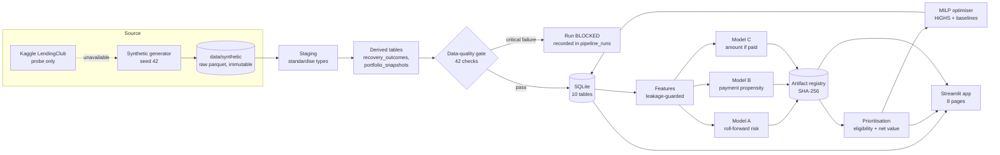

# Architecture

## Layers and modules
| Layer | Module | Responsibility |
|---|---|---|
| Configuration | `config/settings.yaml`, `src/config.py` | Paths, profiles, costs, policy, hyper-parameters |
| Source | `src/ingestion/source_check.py` | Probe the public source; record the decision |
| Generation | `src/data_generation/generate_data.py` | Deterministic simulation |
| Staging / DQ | `src/preprocessing/` | Standardise, derive tables, 42 checks, source-to-target mapping |
| Storage | `src/database/` | Schema with constraints and indexes, transactional idempotent loads, parameterised queries |
| Features | `src/features/` | Point-in-time features, leakage guard |
| Models | `src/models/` | Training, evaluation, explanation, verified registry |
| Decisions | `src/prioritization/`, `src/optimization/` | Eligibility, valuation, MILP, baselines, persistence |
| Analytics | `src/analytics/`, `src/forecasting/` | KPIs, segments, vintages, roll rates, scenarios, forecasts |
| Orchestration | `src/pipeline/run_pipeline.py` | End-to-end run, manifest, generated docs |
| Presentation | `app.py`, `ui/` | Pages, shared components, cached data access |

UI code never trains models or writes SQL directly: it reads processed outputs through
`ui/data.py` (cached) and calls the same engine functions the pipeline uses.

## Idempotency and reproducibility
* Raw source folders are keyed by dataset, generator version, size and seed, and are
  never overwritten.
* Core tables are replaced in a single transaction (delete children → insert), so re-runs
  never duplicate rows; audit tables (`pipeline_runs`, `data_quality_results`,
  `model_runs`, `optimization_runs`) append.
* Seeds are fixed for generation, sampling and model training; package versions are
  recorded in `data/metadata/environment.json`.
